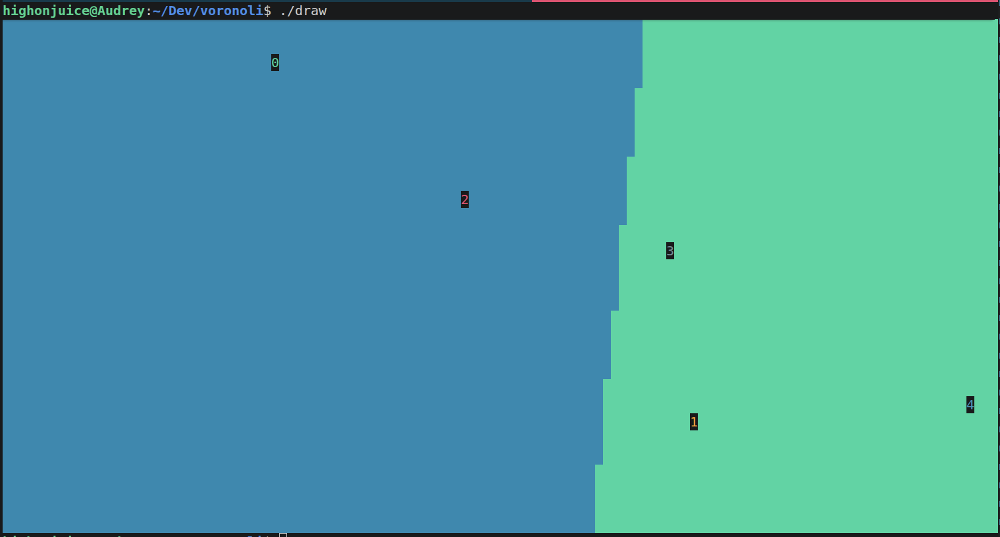

Goal:

I want to create a Voronoi Diagram where I input some cpp / python code, then it outputs the correct voronoi diagram.

For example, if I wanted to input a function of a maximum and a couple points, it creates a farthest voronoi diagram.

Tech Stack:

- I want to draw on the terminal because its lightweight and looks cool
- cpp cuz I'm a chad

Here's what it looks like

